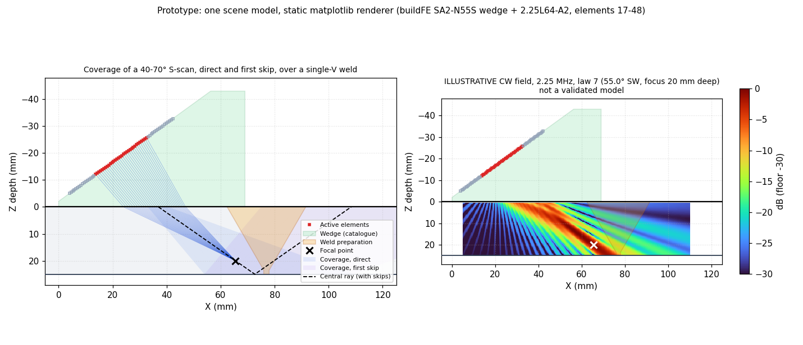
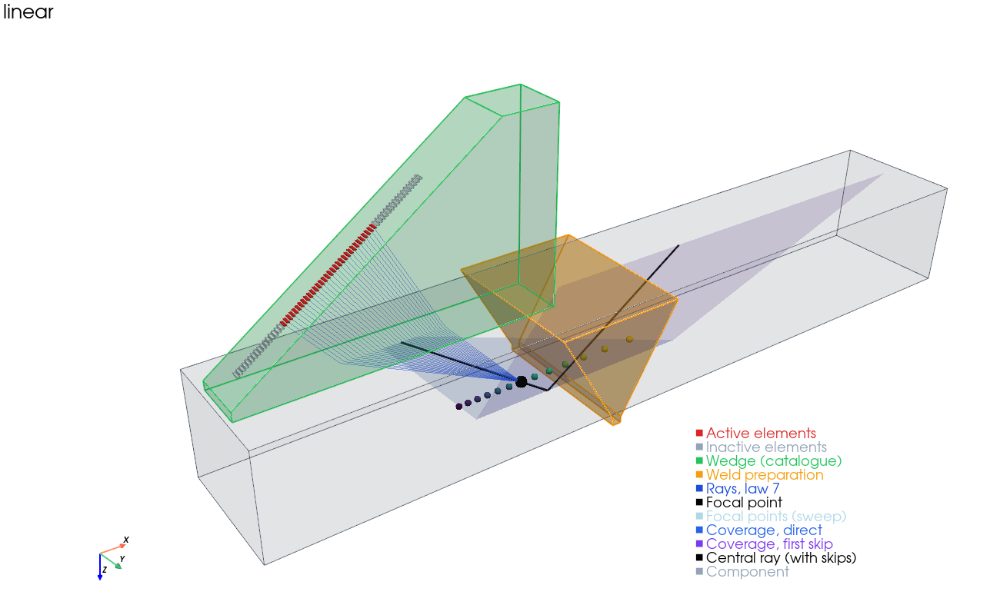
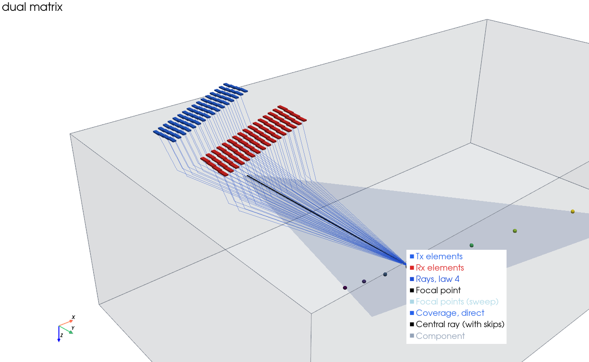
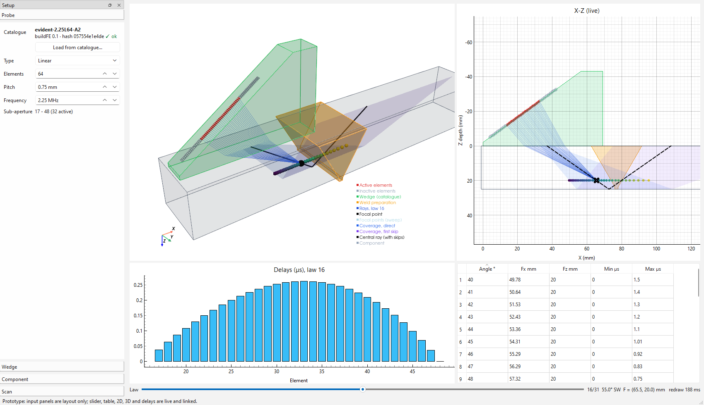

# Plan: visualisation migration to Qt, PyVista/VTK and pyqtgraph

Status: PROPOSED, 2026-11-19, for adversarial review. Prototypes and images in this PR; no change to `python/` or `matlab/`.

## Aim

Make the calculator's visualisation much better, in two ways:
- **How it draws:** proper 3D, live interaction, and views that update together.
- **What it shows:** coverage, skips, weld geometry and, optionally, beam fields.

It moves onto the libraries the suite already uses rather than adding new ones.

## Owner decisions (2026-11-19)

| ID | Decision |
|---|---|
| D1 | The MATLAB GUI may diverge from the Python one. Parity is kept for physics and exports (cross-checked by tests in both languages); the MATLAB GUI stays as it is. |
| D2 | A larger executable is acceptable. Docker: see [Docker](#docker). |
| D3 | Shared widgets go through the suite register (FBK-0019). Owner's answer, 2026-11-19: **the calculator may use parts of other suite components**, copied with an attribution header (origin repository, file, commit); nothing is asked of them, and their repositories are not edited. |

## Current stack and target

| | Today | Target |
|---|---|---|
| GUI toolkit | Tkinter | Qt through **qtpy**, with **PySide6** (LGPL); the same choice as viewFE's ADR-011 |
| 3D | matplotlib mplot3d | **PyVista/VTK** in **pyvistaqt** (viewFE ADR-002) |
| Live 2D | matplotlib (full redraw per tick) | **pyqtgraph** (scaneval's GUI library) |
| Static/report figures | matplotlib | matplotlib, unchanged (PNG/PDF export, tests) |

Why the matplotlib-only plan of `VisualisationReview.md` §4 is overtaken: it chose mplot3d to keep the MATLAB GUI parallel. D1 removes that constraint. viewFE has since documented mplot3d's limits for this kind of scene: no depth sorting and no GPU path.

## Prototypes (in `prototypes/qt_vtk/`, throwaway)

All four are drawn from one **scene model** (`scene_model.py`). The solver and focal rule produce primitives (points, segments, polylines, polygons, prisms, a plate block) in the global frame, in mm, and each renderer only draws them.

**1. Static renderer (matplotlib):** coverage of a 40–70° shear S-scan, direct and first skip, over a single-V weld, using the buildFE SA2-N55S wedge and the 2.25L64-A2 probe. Right panel: an *illustrative* CW field.

**2. PyVista 3D:** translucent catalogue wedge, plate, weld preparation, element glyphs, rays, coverage sheets, the sweep's focal points, and the central ray with skips. The X axis runs left to right.

A dual matrix (16×4 per array, 5° roof, 12° skew), with Tx and Rx coloured separately:

**3. Qt shell:**
- **Setup dock:** input panels, layout only in the prototype; it shows the catalogue entry and its hash status.
- **Views:** pyvistaqt 3D view, live pyqtgraph X-Z view, delay chart, and a sortable law table.
- **Linking:** all of them follow one law slider.

### Measured on the dev laptop (prototype code, not optimised)

| Quantity | Value |
|---|---|
| Solve one law, 32 elements, Python loop | 8.8–9.1 ms |
| Redraw all four views for one law (rebuilds the scene; re-adds the 3D rays) | median 90 ms, max 113 ms |

Recalculating a law (about 9 ms) is fast enough to drag the focal point live. Redrawing is the slow part, and reusing artists instead of rebuilding them each tick (step 4) should bring it well under 50 ms. That target is an estimate to confirm, not a measurement.

### Checks done on the prototypes

- The field adds up coherently at the focus (ratio 1.000000), so the solver's delays and the field's own Fermat times agree.
- The field peak lies about 10 mm in front of the geometric focus. That is consistent with focal shift for this weak focus (about 17 mm refracted aperture), but it is not proven.
- The field model ignores transmission coefficients, element directivity and attenuation, and is labelled *illustrative* on the image. A real field view should come from a validated model; see step 6.

## Inspiration from existing software

This comes from general knowledge of these products; I did not check current versions.

| Product | Idea taken | Where in this plan |
|---|---|---|
| Evident NDT SetupBuilder, Eclipse Scientific ESBeamTool | Coverage of the whole sweep as shaded fans, with skips, over the weld preparation; DXF part and weld import | Steps 5a–5b (prototyped) |
| OmniScan / instrument setup screens | Sweep fan on the part, beam index point, group coverage | Step 5a |
| CIVA, Zetec UltraVision | Beam field maps; per-element delay and aperture display | Step 6; the delay map (already in the Tk app) |
| ParaView (via viewFE) | Picking, clipping planes, linked views | Step 3 |
| arim (Bristol, MIT, cloned at `ProjectsAG/arim`) | Ray paths across views and skips | Reference for 5a |

## Steps

Each step states its finish criteria and what it is needed for. Steps 1–4 replace the GUI. Steps 5–6 add new content and need separate approval.

### 1. Scene model and library focal rules (no visible change)

**Status: done 2026-11-19** (`focal_rules.py`, `FocalRules.m`, `scene_model.py`; see CHANGELOG). The finish criteria are met: 61 of 61 reference images are identical apart from the intended refusal of the parallel vertical-line law, and MATLAB matches the 12 shared cases.

- Move the focal-target rules (constant depth, vertical line, sound path, skew, Y modes) out of `app.py` into a tested library module.
- Add the scene model: dataclasses for primitives in the global frame, in mm, with a role used for styling.
- Make today's matplotlib drawing (`scene.py`) a renderer of that model.

**Finish:**
- Existing tests pass unchanged.
- Focal-rule tests cover every mode (invariants, not stored numbers).
- The Tk app's images match today's for the existing test setups.
- The MATLAB focal rules are cross-checked against the Python ones on a shared case table (D1).

**Needed for:** steps 2–6.

### 2. Qt shell with matplotlib canvases

**Status: done 2026-11-19, except retiring the Tk window, which is left for the owner to accept first.**
- **Qt window:** `qt_app.py`, sharing `session.py` with the Tk window.
- **Parity tests:** `test_qt_gui.py`, covering identical tables, configurations both ways and the ported GUI regressions.
- **Carried from #24's review:** one refusal per requested law in Y sweeps.

- Port the panels, menus, table and dialogs (catalogue picker, configuration) to qtpy/PySide6.
- Embed the existing matplotlib views with `FigureCanvasQTAgg`.
- Keep the Tk app until this one reaches parity, then retire it.

**Finish:**
- Every Tk feature is reachable.
- The GUI regression tests (`test_gui.py`) are ported to Qt and use `pytest-qt` or an equivalent.
- Configuration JSON files saved by the Tk app load unchanged.

**Needed for:** steps 3–4.

### 3. 3D on pyvistaqt

**Status: done 2026-11-20** (`qt_view3d.py`, `scene_vtk.py`). The finish criteria are met:
- every probe type and sub-aperture renders off-screen, with and without the section (`test_view3d.py`);
- picking returns the right element, number, array and grid position on a dual matrix in both numbering conventions.

viewFE was checked for reusable parts (FBK-0019); its viewer is built around FE field cuts and time axes, so nothing was copied. Not done: a free-angle clipping-plane widget (the section is fixed at the aperture's centre).

The renderer (`add_scene` in the prototype) draws from the scene model:
- Wedge, plate and weld as meshes.
- Element glyphs at their real width and elevation when the catalogue gives them.
- Picking an element shows its number in your convention, its delay, time of flight and ray.
- A clipping plane and camera presets.

**Finish:**
- Every probe type and sub-aperture renders, checked by off-screen screenshot tests.
- Picking returns the correct element for row-first and column-first numbering on a dual matrix.

**Needed for:** step 5.

### 4. Live 2D on pyqtgraph

- X-Z and Y-Z views, delay chart, and delay map as an `ImageItem`.
- Artist reuse: update data, never rebuild per tick.
- Linked selection across the views and the table.
- Drag the focal point in the X-Z view to solve and redraw.

**Finish:**
- Redraw per law stays under 50 ms on the dev laptop for a 64-element linear and a 16×4 dual matrix (measured, reported).
- The views stay in step.

**Needed for:** live use of steps 5–6.

### 5. New content: coverage, skips, part and weld geometry (new physics; approval needed)

**5a. Coverage and skips.**
- Draw coverage fans for the sweep's central rays, plus skip legs off a flat backwall.
- Specular reflection, no mode conversion at first (ASSUMPTION, shown on the view). Mode-converted legs come later.

**Finish:** each leg's reflection point lies on the backwall and the angle is preserved, tested for positive and negative skew (rotation-sign rule).

**5b. Part and weld geometry.**
- Weld-preparation templates (single-V, double-V, J), and DXF import of the cross-section, read into the scene model.
- Mark coverage gaps on the fusion faces.

**Finish:** a template weld and a DXF of the same weld give the same polygon to tolerance.

**Needed for:** coverage checks of scan plans for the Pogo-CIVA and weld studies.

### 6. Beam field view (optional; approval needed)

- Check first whether buildFE, imageFE or nde-knowledge already provide a validated field or beam model. If one exists, call it; never re-implement it here.
- Show the field over the X-Z section and on 3D slices.

**Finish:** compared with a reference (CIVA or a buildFE solve) on one case, with the tolerance stated in advance.

## Packaging

- `pyproject.toml` with a `gui` extra (PySide6, qtpy, pyvista, pyvistaqt, pyqtgraph). The library stays usable with numpy and scipy only.
- PyInstaller `onedir` build for colleagues; the larger size is accepted (D2).
- The Tk app remains until step 2 is finished.

### Docker

Docker is useful here for testing and for regenerating the documentation images. It is not useful for shipping the GUI.

- **Not for the GUI:** a Qt/VTK desktop app in Docker on Windows needs an X or Wayland bridge (WSLg or an X server) and an OpenGL path. That makes it more fragile for colleagues than a PyInstaller folder.
- **For headless work:** a Linux image that runs the tests and renders the off-screen VTK screenshots (as the prototype does) would make the images and regression screenshots reproducible, for CI or for the cluster.
- **What still needs checking:** which VTK build renders off-screen headless (an OSMesa or EGL variant, or xvfb). Docker is not installed on this laptop, so nothing was tested. Proposed as optional step 7, after step 3.

## Parts from other suite components (D3, FBK-0019)

viewFE (PyVista/pyvistaqt, PySide6) and scaneval (pyqtgraph, PySide6) already contain pieces this plan needs: a VTK scene widget, image panels and colour-map handling. The owner allows copying them.

How a copy is made:
- It carries a header naming the origin repository, file and commit. Its tests come with it, or are written for it.
- The copy becomes the calculator's own code. A fault found in it goes back to the origin component as a pull request (DEC-0018).
- No runtime dependency on viewFE or scaneval: viewFE is internal-only (its ADR-012), and the calculator must install on its own.
- Candidates are named at steps 3 and 4: viewFE's pyvistaqt viewer and camera handling; scaneval's pyqtgraph image panels and dB colour maps.

## Risks

| Risk | Mitigation |
|---|---|
| VTK or Qt on Python 3.14 wheels | Proven in this prototype environment and in viewFE |
| Scope creep into a simulation tool | Steps 5–6 gated; fields come from a validated source |
| Two GUIs during the port | Tk retired at step 2's finish line, not before |
| Prototype code drifting into production | Prototypes stay in `prototypes/`; production code is rewritten with tests in steps 1–4 |
