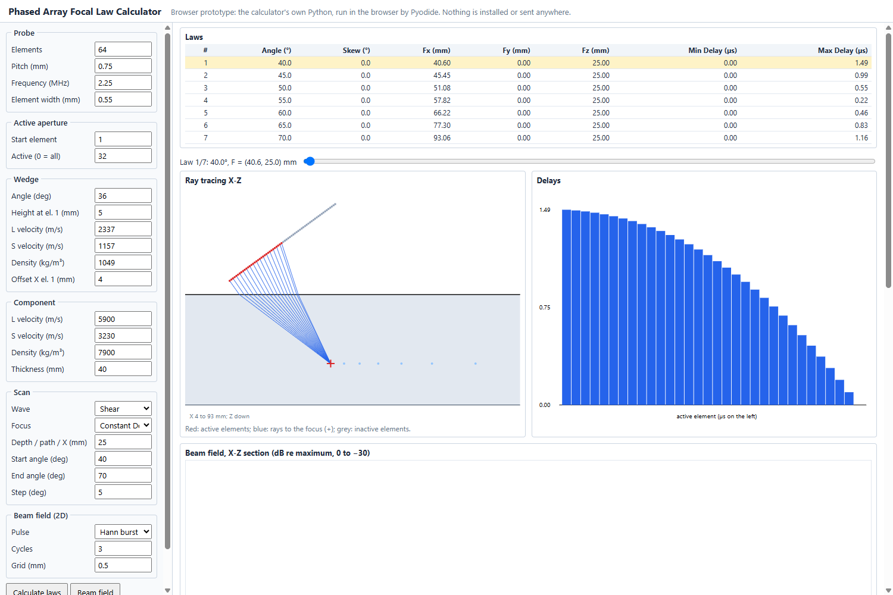
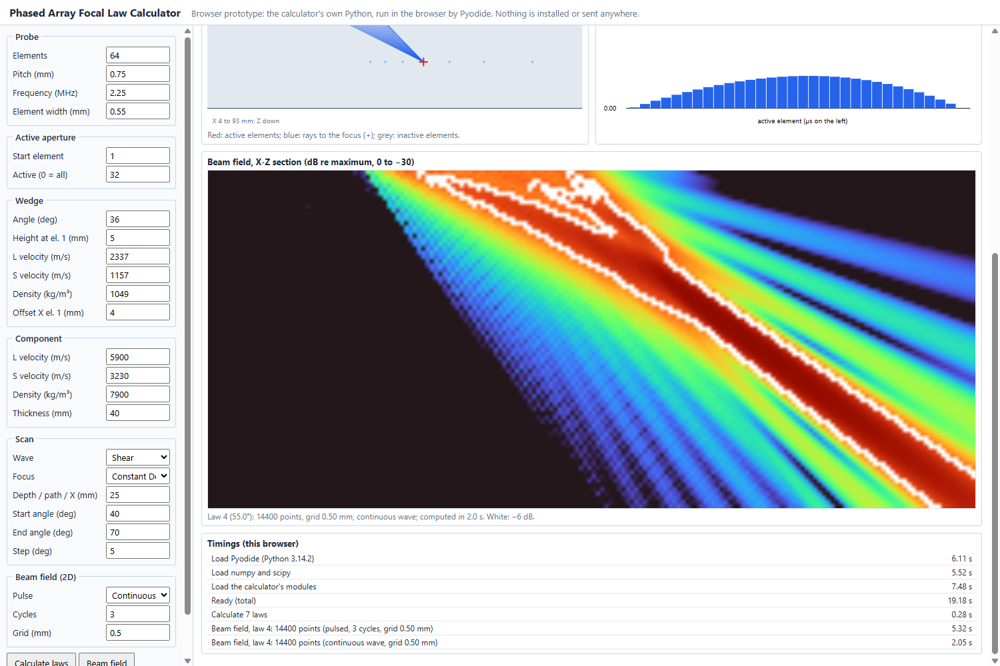

# Plan: the calculator in a web browser

Status: PROPOSED, 2026-11-22, with a working prototype (`web/`) and its measurements. Steps below
need the owner's go-ahead; hosting needs the owner's choice.

## Why, and the constraints

The owner asked (2026-11-21/22) whether the calculator could run in a browser. Laptops at work
now limit what can be installed, so the aim is:
- **nothing to install** on a user's machine: a current browser (Edge, Chrome or Firefox) is enough;
- **no cost**;
- hosted on GitHub Pages, Netlify, or the work network's own server.

## The approach: the calculator's own Python, run in the browser

[Pyodide](https://pyodide.org) runs CPython compiled to WebAssembly inside the browser, with numpy
and scipy. The calculator's library (focal laws, sweeps, the beam field) is plain numpy/scipy, so
it runs there **unchanged**: the browser loads the same `.py` files the desktop window uses. Only
the window is new, a plain HTML/JavaScript page with no framework and no build step.

- Python runs in a Web Worker, off the page's thread, so the page stays responsive.
- **Nothing a user enters leaves their browser.** The web server only hands out files, so a
  confidential setup (CAB02, a client's probe) is never sent anywhere.
- Pyodide 314.0.8 runs Python 3.14.2 with numpy 2.4.6 and scipy 1.18.0, the same Python version
  as the dev laptop. Pyodide 314 ships as ES modules, so the worker is a module worker.

## The prototype (`web/`, built by `tools/build_web.py`)

The prototype covers a linear probe on a wedge:
- inputs: probe, aperture, wedge, component and scan (all three focus modes, either wave);
- **Calculate laws**, which fills the law table;
- an X-Z ray view and a delay chart for the selected law, chosen with the slider or by clicking a table row;
- **Beam field**, the 2D X-Z map in dB with the −6 dB contour, pulsed or continuous wave;
- a timings panel.

### Measured (2026-11-22, dev laptop, Chromium via Qt WebEngine, first visit, served locally)

| Step | Browser (Pyodide) | Desktop Python 3.14 | Ratio |
|---|---|---|---|
| Load Pyodide | 5.6–6.1 s | – | – |
| Load numpy and scipy | 4.9–5.5 s | – | – |
| Load the calculator's modules (mostly scipy's import) | 7.0–7.5 s | – | – |
| **Ready, first visit** | **18–19 s** | – | – |
| Calculate 7 laws (32 elements, 40–70° shear, constant depth 25 mm) | 0.27–0.28 s | 0.09 s | ≈ 3× |
| Beam field, 2D pulsed, 14 400 points | 5.3 s | 3.7 s | 1.4× |
| Beam field, 2D continuous wave, 14 400 points | 2.0 s | 1.7 s | 1.2× |

- The beam field costs much less in the browser than I estimated beforehand (3–5×): numpy's
  vectorised work dominates, and that is compiled code in both.
- The first visit downloads about 30 MB. Browsers normally cache it, so later visits should start
  faster; that was not measured here (the test browser kept no cache).
- The self-contained build (`--offline`, see below) gave the same timings, with every file served
  locally.

What the timings cover: a local server, so the network was not tested. Over a work network or
the internet, the first visit adds the time to download 30 MB.

## Hosting

The site is static: any web server that serves files can host it, with no server-side code or
database. Every option below is free.

| Option | Cost | What the user's machine needs | Who can reach it | Set-up | Notes |
|---|---|---|---|---|---|
| **GitHub Pages** | Free for this repository (it is public) | A browser, and access to `github.io` from the work network | Anyone with the link: the page is public, as is the code already. Inputs still stay in each browser. | The owner sets Settings > Pages > Source to "GitHub Actions"; then `pages.yml` publishes. | URL `https://aledtdavies.github.io/phased_array_calculator/`. Published from `main` by a workflow (manual for now). |
| **Netlify** | Free plan (limits as of my knowledge; check current terms) | A browser, and access to the Netlify domain | Public link; password protection is on paid plans as far as I know (to check) | Connect the GitHub repository in Netlify; `netlify.toml` holds the build | Builds a preview for every pull request, which GitHub Pages does not. Otherwise no advantage here. |
| **Work network server** | Free (the server already exists) | A browser on the work network | Only people on the work network | IT runs one container (`docker/web.Dockerfile`), or copies the site zip into an existing web server | Nothing leaves the building: no internet needed once built. |

**Two ways to serve on the work network:**
1. **Docker:** `docker build -t pac-web -f docker/web.Dockerfile .`, then
   `docker run -d --restart unless-stopped -p 8080:80 pac-web`. This is nginx serving the
   self-contained site. CI builds the image, runs it and checks the content types browsers need.
2. **No Docker:** the CI artefact `pac-web-site.zip` (from the `headless` workflow) is the
   finished site. It can be unzipped into any web server IT already runs (IIS, Apache, nginx).
   The server must send `.mjs` as `text/javascript` and `.wasm` as `application/wasm`. Older IIS
   versions need those two types added once.

**Self-contained build.** `python tools/build_web.py site --offline` copies Pyodide's core and the
numpy and scipy wheels (30 MB) beside the page. The site then loads nothing from the internet. I
recommend it for every host: it also avoids depending on the public CDN (jsDelivr) being
reachable from work.

**What does not work: opening the files from a shared drive** (`file://`). Browsers refuse to run
the worker and fetch the modules from local files, so the site has to be served over http.

**Recommendation.**
- **GitHub Pages first**, to try it with colleagues: free, nothing to install, a single click to
  enable, and the repository is already public. First check that the work network reaches
  `aledtdavies.github.io`.
- **The work server** if the page must stay internal, or if `github.io` is blocked. That needs
  one container, or the zip in an existing web server.
- **Netlify** only if previews of each pull request are wanted.

## Checks before relying on it at work

- **The browser:** Edge or Chrome from 2023 on (module workers and WebAssembly). Most
  organisations allow WebAssembly; a locked-down policy can disable it. Test once on a work
  laptop by opening the page. UNKNOWN until tried.
- **The network:** whether `github.io` (or Netlify) is reachable from work. UNKNOWN until tried.
  The work-server route avoids the question.

## Steps

**Status 2026-11-22:** step 1 published on GitHub Pages (owner's choice); steps 2 and 3 done
(owner: "be nice if it worked on mobile, looked a bit nicer and had full functionality"); step 4 next.
The work-laptop check of step 1 is still the owner's to make.

1. **Publish the prototype** on the chosen host and try it on a work laptop.
   - **Finish:** the page loads on a work laptop with nothing installed, and the timings are
     recorded there.
   - **Needed for:** deciding whether to go on.
2. **Feature parity for everyday use:**
   - matrix and dual probes, skew and Y modes, roof;
   - catalogue JSON and configuration files, opened through the browser's file picker (read
     locally, never uploaded);
   - CSV and configuration downloads;
   - coverage and skips;
   - welds from templates.
   - **Finish:** the browser's law tables equal the desktop's on the shared scan cases (a test,
     like `test_web.py`), and every item works on a work laptop.
   - **Done 2026-11-22** (except the work-laptop check): `test_web.py` gives the desktop's table and
     delays on every case of `test_qt_gui.SCAN_CASES` (linear, matrix with skew, Y sweeps, refusals);
     the views draw the desktop's own scene primitives (`scene_model.py`); configurations save and
     reload unchanged in the browser; layout for phones (setup slides in) and wider screens.
3. **DXF welds:** ezdxf 1.4.5 has a pure-Python wheel (`py3-none-any`), and so do its
   dependencies, so Pyodide can install it; the self-contained build would copy it in.
   Expected, not yet tried.
   - **Finish:** a DXF weld opened in the browser equals the desktop's profile to 0.01 mm.
   - **Done 2026-11-22:** in the browser, the single-V drawn as a DXF gives the template's fusion
     result exactly (80 % covered, gaps 11.2 mm of 57.3 mm), through `weld.dxf_profile` itself
     (the desktop's code); the first DXF loads ezdxf in a few seconds.
4. **3D view** in the browser (three.js or vtk.js) and the 3D beam field (continuous wave).
   - **Finish:** the 3D scene's items and the field sections match the desktop's.
5. **Decide the desktop window's future** once the browser version is in use. The library stays
   one, shared by both.

## Files (prototype)

- `web/index.html`, `web/app.js`: the page; `web/worker.js`: Pyodide in a Web Worker;
  `web/pac_web.py`: the Python layer over `session.py` and `beam_field.py`.
- `tools/build_web.py`: assembles `site/` (with `--offline`, Pyodide copied in).
- `python/test_web.py`: the web layer gives the desktop calculation.
- `docker/web.Dockerfile`, `docker/web-nginx.conf`: the work-network server.
- `.github/workflows/pages.yml`: GitHub Pages (manual); `netlify.toml`: Netlify.
- `.github/workflows/headless.yml`, job `web`: builds and checks the web image, and uploads the site zip.
